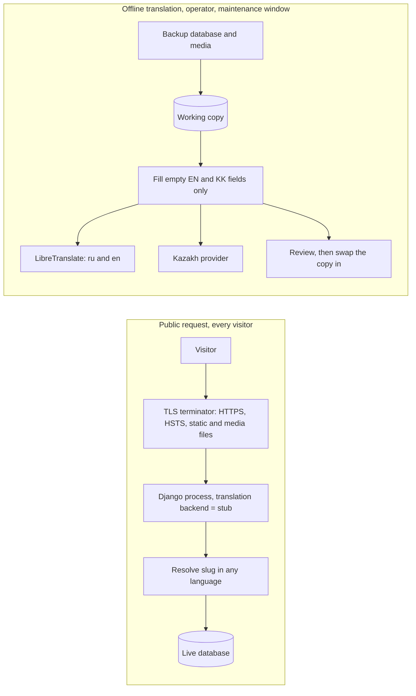

# Stabilizing the Kazakhstan National Federation of UNESCO Clubs website


Paid stabilization of the website of the Kazakhstan National Federation of UNESCO Clubs (Russian, English, Kazakh). The job was to make a live Django site safe to keep running. A visual redesign was out of scope, so this repository is the engineering record, not a design portfolio.

This is an independent write-up by the contractor. It contains none of the site's code, templates, content, or data. It is not the federation's website and not an official UNESCO project.

## The essays

- [Security](docs/security.md): secrets out of the repository, debug off, a login wall on the club cabinet, and a `check --deploy` report where every warning has a named owner.
- [Privileges](docs/privileges.md): the environment limits the process, the `is_staff` and `is_superuser` flags limit people, and the two need separate work.
- [Dependencies](docs/dependencies.md): Django 4.2.2 to 4.2.30 inside the LTS line, and why 5.2 is a separate project.
- [Languages and translation](docs/translation.md): cross-language slugs, a stub on the public process, and hybrid machine translation that only fills empty fields.
- [Database](docs/database.md): the three ways a site of this shape fails later — integrity, operations, overload.
- [What comes next](docs/what-next.md): the funding order, from a proven restore to Postgres.

A short note on [design](docs/design.md) explains why the pages kept their existing look. [docs/reading-order.md](docs/reading-order.md) has a ten-minute and a thirty-minute path.

## Two paths through the system

Visitors and translation never share a process. A page request reads the database and renders whatever text exists in the requested language. Machine translation is an operator's batch job, run on a copy after a backup, and it writes only into empty fields.



## Scale

Four Django apps, on the order of forty views, a trilingual content model built on `django-modeltranslation`, and one SQLite database. The contract ran for several weeks at the end of August 2026. At handover the project had seventeen automated tests, all passing, and `manage.py check` reported no issues.

## Hardships

- **No access to production.** The work shipped as a branch with a deploy guide. Every server-side decision had to be written down so the operator could apply it without the contractor present.
- **The declared dependencies did not match reality.** `requirements.txt` listed two packages the code never imported, carried in from an unrelated setup file, and pinned older versions than the environment actually ran. The first job was making the file describe the real environment.
- **The development machine ran an unsupported Python.** Django 4.2 is certified up to Python 3.12; the machine ran 3.14. The Django test client failed there, so the tests use `RequestFactory`. Production is advised to run 3.12.
- **No free engine speaks all three languages.** LibreTranslate covers Russian and English. Kazakh needed its own provider behind the same interface, and paid cloud translation needed the client's written approval first. Additionally, Libretranslate does not feature native support of kazakh language, which required.
- **Scope was fixed in writing.** A major Django upgrade, a Postgres move, and a redesign were each out of scope. Each got a written note instead of a half-finished attempt.

## Funding order
Before attempting to fix the website several safety regulations must have been implemented. It is including:

1. A backup and restore that has been rehearsed onto an empty folder.
2. Leave all data and posts intact, and working seamlessly after site refactor.
3. The privilege cut: one break-glass superuser, an editor group for daily publishing, the superuser checkbox off the everyday form.
4. Translation inside the editor, so English and Kazakh stop drifting behind Russian.
5. One visual system, as its own project.
6. A product decision on the club cabinet.
7. HTML filtering for stored articles, and a map that does not load third-party script on every page.
8. PostgreSQL and Django 5.2, rehearsed on a copy of the data.

Details and reasons are in [docs/what-next.md](docs/what-next.md).

## Examples

[examples/](examples/README.md) holds small annotated modules, each marked `Status: shipped` or `Status: recommended`. Shipped modules distill patterns that went live. Recommended modules show the next cut; the contract did not build them. The pure-Python checks run without Django:

```
python3 examples/test_examples.py
```

## License

MIT for this write-up and the example modules. See [LICENSE](LICENSE).
