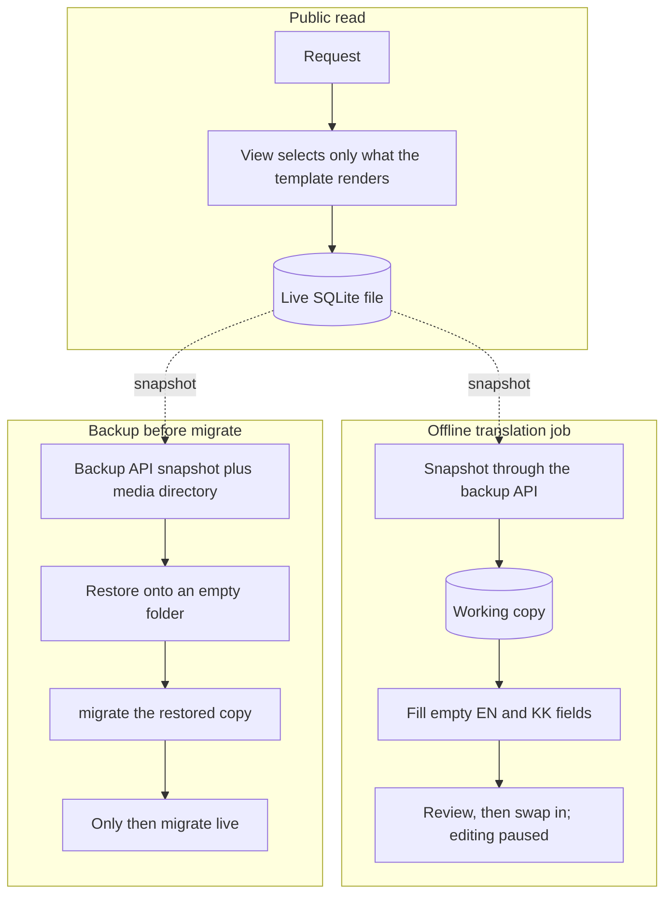

# Database

**Shipped.** The contract did not restructure the schema. What shipped around the database: list queries that stopped hiding rows with an empty translated title, slug lookup across all three languages, a translation command that writes only empty fields and is run after a backup, and a written note that PostgreSQL and Django 5.2 belong to a separate project rehearsed on a copy of the data.

**Pattern.** A small site fails later in three ways. *Integrity*: the schema allows states the business never wanted. *Operations*: the backup has never been restored. *Overload*: one writer and wide queries make the site feel fragile long before it is big. Each has a cheap fix while the data is small and an expensive one after a migration makes the mistakes permanent.

This essay describes the shape of the problem. It contains no column list from the real models. [examples/schema_rules.py](../examples/schema_rules.py) is a fictional sketch.

## Integrity

- **Slugs.** A slug that is indexed but not unique lets two articles answer on the same URL; the lookup then returns whichever the database finds first, or raises. A `UniqueConstraint` makes the database refuse the second one. With per-language slug columns, each column needs its own constraint.
- **Deletion from an organization to its articles.** `on_delete=CASCADE` from a club to its articles means deleting the account deletes that club's archive. Years of published news vanish in one click in the admin. `PROTECT` makes the delete fail until someone reassigns or archives the articles on purpose.
- **Taxonomy.** Categories and similar lookup rows should be `PROTECT`. A lookup row must not disappear while articles still point at it.
- **Authorship.** An article's author should be `SET_NULL`. The article outlives the person's account.
- **Identity and dossier.** The login and the organization's file should be two tables. Deleting or permissioning a login must be a different operation from correcting the organization's public details. When both live in one row, the admin form for one is the admin form for the other, which is the checkbox problem in [privileges.md](privileges.md).
- **Translation columns.** `title_en` and `title_kk` beside `title_ru` are fine at three languages. They become an editorial problem (empty cells) long before they become a storage problem.

## Operations

One SQLite file is a reasonable store at this size. Copying that file while the site is running is not a backup: a write in flight can leave the copy inconsistent, and nobody finds out until the restore. The safe snapshot uses SQLite's online backup API (in Python, `Connection.backup`), together with the media directory, which holds every uploaded image the database refers to.

A backup counts once it has been restored: onto an empty folder, followed by `migrate`, followed by opening a page and the admin. That rehearsal is also the first step of every schema change.

A translation batch holds a write lock while it saves. On the live file it would block editors, and a failure halfway would leave half-translated rows. It runs on a copy, in a maintenance window with editing paused, so swapping the copy back in loses nothing.



## Overload

SQLite allows one writer at a time. When several editors save at once, some requests wait and some fail with "database is locked". Users describe that as "the site is fragile", and it never shows up as a slow query.

Separately, a page that loads every club, city, and category on views that display none of them gets slower for the whole site as the directory grows. The fix is in the query: select only what the template renders, paginate lists, and index the columns you actually filter on (for a public list, typically the published flag and the date). A cache in front of those queries hides the shape and adds invalidation bugs, so it comes after the query is right.

## PostgreSQL, later and on purpose

PostgreSQL removes the single-writer limit, and it is the right home once several editors work daily. It comes after a restore rehearsal, because the move is the moment a bad `CASCADE` or a missing unique constraint becomes permanent: data that violates a constraint has to be cleaned before the constraint can exist, and after the move the old file stops being the source of truth.

Database roles are a separate layer from Django's flags. The application connects as a role that can read and write its tables and cannot drop the database or create roles. A Django superuser is still limited by what that role may do.

## Takeout (Recommended)

From [examples/schema_rules.py](../examples/schema_rules.py). Fictional and not shipped; it does not mirror the live schema.

```python
# Status: recommended
class Organization(models.Model):
    account = models.OneToOneField(
        settings.AUTH_USER_MODEL, on_delete=models.SET_NULL, null=True, blank=True,
        related_name="organization",
    )


class Article(models.Model):
    organization = models.ForeignKey(Organization, on_delete=models.PROTECT, related_name="articles")
    author = models.ForeignKey(
        settings.AUTH_USER_MODEL, on_delete=models.SET_NULL, null=True, related_name="articles"
    )
    category = models.ForeignKey(Category, on_delete=models.PROTECT, related_name="articles")
    slug = models.SlugField(max_length=300)

    class Meta:
        constraints = [models.UniqueConstraint(fields=["slug"], name="article_slug_unique")]
```
