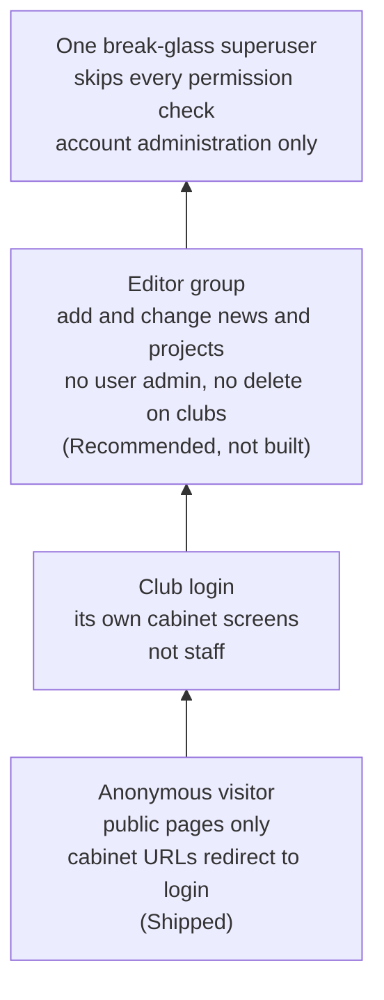

# Privileges

**Shipped.** Secrets and debug mode moved into the environment, with debug off by default. The club cabinet stopped raising a 500 for anonymous visitors: those screens now redirect to a login page that exists. The contract did not rebuild groups, change the admin forms, or remove any privilege checkbox.

**Pattern.** Two locks, often confused. The environment limits the *process*: what it knows and how it behaves. The `is_staff` and `is_superuser` flags limit *people*: who may open the admin and who skips every permission check. Securing one does nothing for the other. The daily publishing role should never need the superuser checkbox.

## The environment limits the process

`SECRET_KEY`, mail credentials, and `DEBUG` come from the environment. That keeps the keys out of every clone of the repository and makes a production process quiet by default. It is a statement about the *server*. It does not decide which human being can edit users, and a person who logs in as a superuser never touches the environment at all.

## Flags limit people

- **`is_staff`** means "may open the admin". On its own it grants nothing inside the admin; every screen still asks for a model permission.
- **`is_superuser`** skips permission checks entirely. That account can create another superuser, read every club's file, and delete the archive. It is a break-glass account: one of them, used for account administration, never the daily login.
- **A club login** is not staff. The cabinet is the club's own screens on the public site. The stabilization made those screens safe for anonymous visitors by redirecting them to login.
- **An editor group** is the recommended next cut: add and change news and projects, no user administration, no delete on clubs. The contract did not build it.



## The honest line

On this site the login and the organization's dossier are the same model, and the admin form still shows `is_superuser` beside that dossier. Moving secrets to `.env` did not remove that checkbox. Anyone trusted to correct a club's details in the admin sees the control that turns an account into a superuser on the same page.

## The recommended cut

[examples/admin_scope.py](../examples/admin_scope.py) is labeled **Recommended**. It was not shipped. It does three things:

1. Strips `is_superuser`, `is_staff`, `groups`, and `user_permissions` from the fieldsets unless `request.user.is_superuser`.
2. Scopes the queryset so a non-superuser sees only rows it owns.
3. Defines an editor group whose permissions contain no `delete_` codename and nothing from `auth`, with a check that fails if someone adds one.

Around the code, the operational rules:

- Exactly one superuser. Audit it with a query that counts accounts where `is_superuser` is true, and treat any second one as an incident.
- Create that account from a shell on the server with `createsuperuser`, never from the admin form.
- Daily publishing happens from editor-group accounts.
- Longer term, split the login from the dossier (see [database.md](database.md)), so that granting admin access and correcting an organization's details stop being the same form.

Django's own reference for the flags and permissions: [Permissions and authorization](https://docs.djangoproject.com/en/4.2/topics/auth/default/#permissions-and-authorization).

## Why it matters

A stolen editor password should cost you articles, which you restore from last night's backup. A stolen superuser password costs you the user table: new administrators, changed passwords, deleted clubs, and no way to tell which accounts to trust afterward. The superuser flag is how a content compromise becomes an identity compromise. Keeping it off the everyday form is cheap, and it changes what the worst day looks like.

## Takeout (Recommended)

From [examples/admin_scope.py](../examples/admin_scope.py). Not shipped; the contract did not change the admin.

```python
# Status: recommended
PRIVILEGE_FIELDS = frozenset({"is_superuser", "is_staff", "groups", "user_permissions"})


def strip_privilege_fields(fieldsets, *, is_superuser):
    """Return the fieldsets without privilege fields unless the viewer is a superuser."""
    if is_superuser:
        return tuple(fieldsets)
    scoped = []
    for title, options in fieldsets:
        fields = _without_privileges(options.get("fields", ()))
        if fields:
            scoped.append((title, {**options, "fields": fields}))
    return tuple(scoped)


class ScopedAccountAdmin:
    def get_fieldsets(self, request, obj=None):
        fieldsets = super().get_fieldsets(request, obj)
        return strip_privilege_fields(fieldsets, is_superuser=request.user.is_superuser)
```
